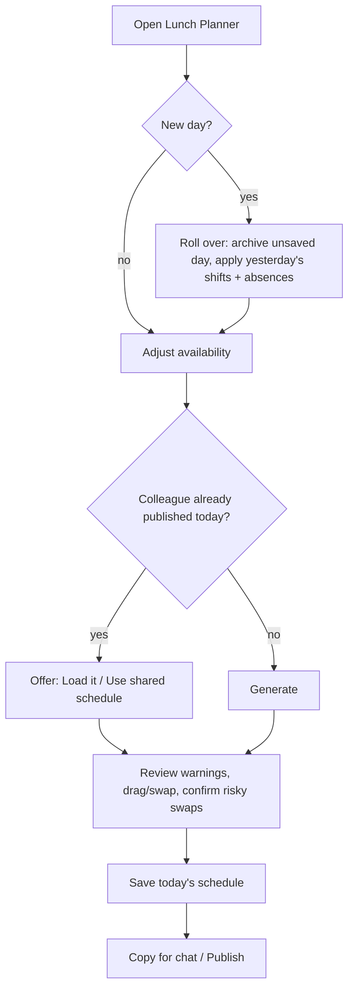
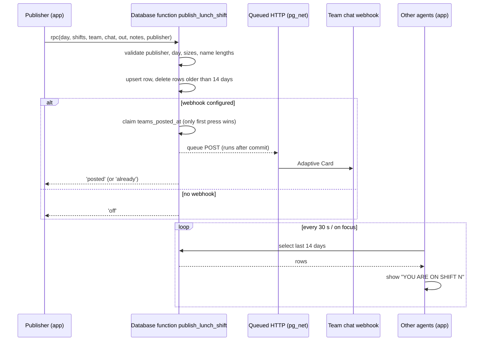
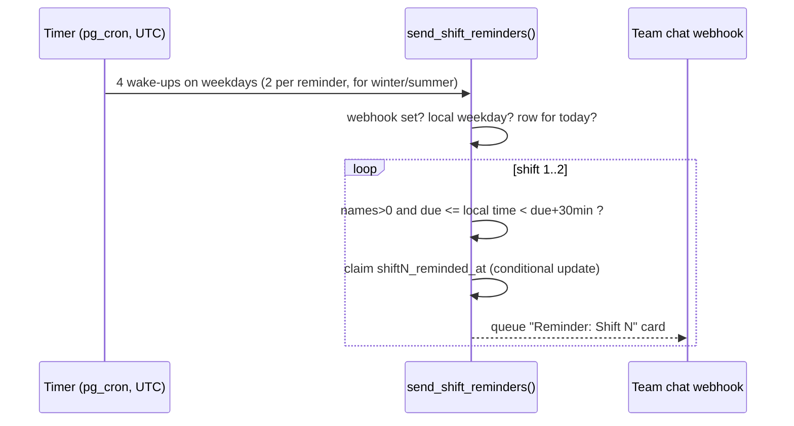

# Feature spec: Lunch Scheduler (planner + automatic sharing + reminders)

> Status: **as-built documentation of the current app**, written to recreate it in a new repository.
> Source of truth in the old code: `src/features/lunch/`, `src/features/shift/`, `src/features/dashboard/`,
> `supabase/lunch_shift.sql`, `supabase/lunch_reminders_schedule.sql`.
> Sanitized: no real names, addresses, keys or webhook URLs. "Publisher A/B" and "Agent A…" are placeholders.

## 1. Why this exists (purpose)

A support team that must keep the queue covered at lunch splits into **two lunch shifts**. Doing that by hand every day is slow and
unfair, and has three recurring failure modes: (1) a **language** has nobody left in one shift, (2) the **same people** always get
the same shift, (3) people **forget** their shift or do not know it.

The feature therefore does three jobs:

| Job | Where it runs | Automatic? |
|---|---|---|
| **A. Plan** – generate and hand-adjust a fair two-shift schedule | Browser/desktop app, pure logic | On demand (button) |
| **B. Share** – publish today's schedule so everyone sees "you are on Shift N" and the chat gets a summary | App → database function → chat webhook | Semi: one press by a publisher triggers it |
| **C. Remind** – post "Reminder: Shift N lunch" at two fixed times | Database scheduler (no app open) | **Fully automatic** |

Out of scope today: accounts/permissions, holidays, more than two shifts, per-agent preferences beyond "early shift".

## 2. Actors

| Actor | Can do |
|---|---|
| **Planner** (a publisher) | Edit roster, generate, swap, save, publish |
| **Viewer** (any agent) | Pick "I am", see own shift, dashboard lunch alert |
| **Scheduler job** (database timer) | Send reminders |
| **Chat webhook** (external) | Receive cards |

## 3. Domain model

```
Agent        id, name, languages[], chat:boolean, earlyShift:boolean, available:boolean, yesterdayShift: 1|2|null
Schedule     date, shift1: agentId[], shift2: agentId[]          (ids; derived views add names)
HistoryEntry date, shift1[], shift2[], chat[], out[], notes[]     (NAMES, so old days stay readable after roster edits)
LunchData    agents[], history[], schedule|null, syncedDate, sharedKey?      (one snapshot)
SharedDay    day(PK), shift1[], shift2[], team[], chat[], out[], notes[], published_by, updated_at,
             teams_posted_at, shift1_reminded_at, shift2_reminded_at       (database row, names only)
Settings     teams_webhook_url (secret), shift1_reminder_time=11:45, shift2_reminder_time=12:30, reminder_timezone=Europe/Brussels
```

Where each lives today: `LunchData` → browser `localStorage` (key `lunch:data`, one snapshot, via a storage interface).
`SharedDay` + `Settings` → Supabase (Postgres). "I am" → `localStorage` (`shift:me`). Dashboard favourites → `localStorage`.

## 4. Business rules (each should become a test in the new project)

### 4.1 Scheduling (pure function `generateSchedule`)

| ID | Rule | Notes / source |
|---|---|---|
| LS-R1 | Only **available** agents are scheduled. | scheduler.ts |
| LS-R2 | Every candidate split gets a **cost**; lower wins. Tiers are far apart on purpose so a soft wish never beats a hard rule. | weights below |
| LS-R3 | A language with **≥2 speakers** and none in a shift costs **10 000**. | `UNCOVERED_LANGUAGE` |
| LS-R4 | A language spread unevenly costs **100 per head** of imbalance *beyond what parity forces* (3 speakers → 2/1 is free). | `LANGUAGE_BALANCE` |
| LS-R5 | A language with **one speaker** can go anywhere and costs nothing (cannot be covered or unbalanced). | implicit |
| LS-R6 | Shift sizes differ → **80 per head** beyond parity; chat agents differ → **80 per head** beyond parity. | `SIZE_BALANCE`, `CHAT_BALANCE` |
| LS-R7 | Early-shift agent placed in Shift 2 → **60** (soft). | `EARLY_SHIFT_IN_2` |
| LS-R8 | Staying on yesterday's shift → **40** per agent (soft). Net effect: *turn yesterday around* when the hard rules allow. | `SAME_AS_YESTERDAY` |
| LS-R9 | Random noise ≤ 1 per agent-shift so equal splits vary between runs; injectable `rng` for repeatable tests. | `TIE_BREAK_NOISE` |
| LS-R10 | Search: 40 restarts; restart 0 starts from "yesterday flipped"; each restart does greedy descent with single moves + pair swaps; cheapest wins. Output sorted by name. | `RESTARTS` |
| LS-R11 | English is assumed for everyone and **never tracked**; imported data carrying it is stripped. | config.ts |

Keep tier invariant: *one soft preference < one unit of balance < uncovered language*.

### 4.2 Language warnings (`analyzeSchedule`) — same function drives UI warnings, chat NOTES block and swap checks

| Kind | Condition | Message |
|---|---|---|
| `none` | 0 speakers available today | "No X speaker available today" |
| `single` | exactly 1 speaker | "Only one X speaker today (name), no backup" |
| `uncovered` | ≥2 speakers but a shift has none | "No X speaker in Shift N" |

### 4.3 Manual edits

- LS-R20 Drag onto a card in the other shift = **swap**; onto the column = **move**; a **Swap** button gives keyboard access.
- LS-R21 A move/swap that creates a **new** `uncovered` warning (not one that already existed) asks for confirmation (`coverageLost`).
- LS-R22 Warnings recompute after every change.
- LS-R23 The displayed board is **derived** from stored ids + current roster: a deleted/unavailable agent drops out; a newly available agent shows as **unassigned** (never silently left out).

### 4.4 Day roll-over and history

- LS-R30 History window **30 days**. A save for the same date replaces the old one.
- LS-R31 "Yesterday" = the **latest saved working day before today**; weekends are skipped, so **Monday reads Friday**.
- LS-R32 First time a new day is seen (`syncedDate != today`): archive an unsaved earlier schedule into history; copy yesterday's shift onto each agent; anyone listed **out** that day becomes unavailable, anyone who **worked** becomes available, agents not in the entry keep their state; drop a stale schedule. Idempotent.
- LS-R33 Absences persist day to day until cleared (**Everyone available** resets).
- LS-R34 Roster imports/exports CSV (`,` or `;`) and JSON; JSON export also carries history.
- LS-R35 All stored/imported data passes through **revive** functions that check and default every field.

### 4.5 Sharing (database function `publish_lunch_shift`)

| ID | Rule |
|---|---|
| LS-R40 | Only names on the **publisher list** (case-insensitive) may publish. **The list exists twice (SQL and client) and must be kept in sync by hand** → fix in rebuild. |
| LS-R41 | Day must be within **1 day of today** (message says "only for today"). |
| LS-R42 | Limits: shifts ≤ 60 names, team ≤ 120, chat ≤ 60, out ≤ 60, notes ≤ 10; each name 1–40 chars, each note 1–160 chars. Client trims/truncates before sending. |
| LS-R43 | Publishing is an **upsert by day**; the Teams-posted flag is deliberately not reset by a re-publish. |
| LS-R44 | Rows older than **14 days** are deleted on every publish. |
| LS-R45 | Public read access: **last 14 days only**, names/shifts only. No direct insert/update/delete. |
| LS-R46 | **Chat post once per day**: a single conditional `UPDATE … WHERE teams_posted_at IS NULL` claims the post, so two simultaneous presses post once. Returns `posted` / `already` / `off`. |
| LS-R47 | No webhook configured → feature silently off (`off`). |
| LS-R48 | Client: with no backend key configured the whole feature is off and makes **no requests**. |
| LS-R49 | A published day **replaces** the same day saved locally ("it is what the team was told"). |
| LS-R50 | Earlier published days become **history on every computer**; roster is brought up to date once per *new* last-working-day (key = date + shifts + out); later local availability changes are left alone (`adoptShared`). |
| LS-R51 | Today's published schedule is **offered**, not filed: "Load it" / "Use the shared schedule". Loading makes exactly the people in it available and everyone else unavailable; names unknown to the roster are listed and skipped (`scheduleFromShared`). |
| LS-R52 | Viewers: "I am" list = newest published team ∪ local roster ∪ current pick; sorted A–Z. Sidebar shows **YOU ARE ON SHIFT N** only if a row exists for *today* and the person is in it. Yesterday is ignored. |
| LS-R53 | Client polls every **30 s**, on window focus and on tab-visible; offline = keep what is on screen, try again later. |

### 4.6 Reminders (database function `send_shift_reminders`, driven by a timer)

| ID | Rule |
|---|---|
| LS-R60 | Fires **Mon–Fri**; times are settings (default Shift 1 **11:45**, Shift 2 **12:30**) in a configurable **time zone** (default Europe/Brussels). |
| LS-R61 | The timer wakes at **both UTC offsets** for each time (winter/summer); the function checks the **local clock** itself, so the non-matching wake-up does nothing. No DST code needed. |
| LS-R62 | A reminder is due when `due ≤ local time < due + 30 min`; later than that is **skipped** (no stale reminders). |
| LS-R63 | Needs a **published schedule for today**; none → nothing sent. A shift with no names → skipped. |
| LS-R64 | **At most once per shift per day**: claim with a conditional `UPDATE … reminded_at IS NULL` *before* posting. |
| LS-R65 | Message: "Reminder: Shift N lunch — Remember to take your lunch. Agents: …" using the names published that day (so a swap published before the time is included). |
| LS-R66 | No webhook set → nothing sent. |
| LS-R67 | Not callable by the public key; only the timer / admin. |

### 4.7 Dashboard

- LS-R70 Lunch windows: Shift 1 **11:45–12:30**, Shift 2 **12:30–13:15** (local clock, updated each minute). If the picked person's shift is in its window, show a prominent "It's lunch time!" alert.

## 5. Workflows

### 5.1 Daily planner flow



### 5.2 Publish → chat post (sequence)



### 5.3 Reminder run (automatic)



## 6. Dependencies and required configuration

| Need | Today | Rebuild note |
|---|---|---|
| Database | Hosted Postgres with REST + RPC (Supabase) | Any Postgres; keep logic in functions *or* a small API |
| Scheduler | `pg_cron` | Keep close to the data; or a platform cron calling an endpoint |
| HTTP out | `pg_net` queued POST | Needs an **outbox** (see §8) |
| Chat | Workflow webhook accepting Adaptive Cards | Put behind a `Notifier` interface |
| Secrets | Webhook URL in a private table | Env/secret store, never in repo |
| Public client key | In `src/features/shift/config.ts` | Environment variable |
| One-time setup | Paste SQL in editor, enable cron extension, run schedule SQL, store webhook | **Versioned migrations** + setup script + checklist |

**Required-links register (what must exist for the automation to work):**
database project URL · public client key · webhook URL (secret) · cron extension enabled · schedule SQL applied ·
publisher list · reminder times · time zone.

## 7. Error handling today (and gaps)

| Situation | Today | Gap |
|---|---|---|
| Backend unreachable on poll | Keep stale data, retry later | No "offline/stale" indicator |
| Publish rejected (not a publisher, bad day, too long) | Client returns `null`; server message is swallowed | **No user-visible reason** |
| Publish succeeded, webhook failed | Post flag already claimed → **never retried**; failure only visible in `net._http_response` | Need status + retry + visible failure |
| Reminder claimed, post failed | Same: marked as sent, never resent | Same |
| Timer late > 30 min | Reminder skipped by design | Acceptable, but should be logged |
| Public holiday / team day off | Reminder sent if a schedule was published | Add non-working-day calendar |
| Timer silently stopped | Only visible in `cron.job_run_details` | Add a health check |
| Corrupt local data | Revive functions default fields; unreadable JSON → empty | Add export-before-reset prompt |
| Doc drift | A client comment says chat/out/notes are "not stored", but the table stores them | Keep docs generated from the schema |

## 8. Known weaknesses → proposed target design

1. **Honor-system identity.** Anyone with the public key who knows a publisher name can publish (worst case: change today's shifts).
   Target: lightweight auth (magic link or per-team join code) and a `members(role)` table instead of two hard-coded lists.
2. **Publisher list in two places** (SQL + TS). Target: one `members`/`roles` table; the client reads its own role.
3. **At-most-once with no visibility.** Target: an **outbox** table (`id, kind, payload, status: pending|sent|failed, attempts, last_error, run_after`),
   a worker that retries with backoff, and a read-only "last runs" view in the app.
4. **Times, time zone, webhook, publishers are settings rows**, edited from an admin screen (not SQL).
5. **Holiday / non-working-day calendar** per team; reminders skip those.
6. **Notifier abstraction** (`ChatNotifier`): Teams card, Slack block, email, in-app push; message templates in data.
7. **Schema as migrations** (`supabase/migrations/…`), with a CI check that applies them to an empty database and runs SQL tests.
8. **Injected clock** (`now`) everywhere (already true for `send_shift_reminders(p_now)`; copy that pattern to the client logic).
9. **Realtime instead of polling** (subscribe to the table) with polling as fallback.
10. **Generalize "language"** into *skills* (language, product, queue) so coverage rules work for any skill set; keep English-style "assumed skills" as config.
11. **More than two shifts** and **per-agent unavailability windows** (e.g. cannot go before 12:30).
12. **Fairness ledger**: count how often each agent got Shift 1/2 over 30 days; make fairness an explicit, visible metric.

## 9. Test plan to carry over

- Scheduler: seeded `rng`; cases for each of LS-R3…R8, odd counts, one-speaker language, all unavailable, 1 agent.
- Coverage/swap: `coverageLost` returns only *new* gaps.
- History: Monday→Friday, weekend saves ignored, replace same day, 30-day trim.
- `rollOver` idempotence; `adoptShared` key change rules; `scheduleFromShared` unknown names.
- Revive/normalize: malformed JSON never reaches the UI.
- Database (SQL tests): non-publisher rejected, day ±1, size limits, upsert keeps `teams_posted_at`, claim-once under concurrency,
  reminder window edges (due−1 min, due, due+29, due+30), weekend, DST days, empty shift.
- Contract test: client `reviveDays` against a real row shape.

## 10. Open questions for you (answer later; none block documentation)

1. Is "two shifts, languages, chat balance" the full rule set, or are there rules that only live in your head (e.g. seniority, training days)?
2. Should the rebuilt app keep working **without any backend** (local-only mode)? The current one does.
3. Do you want accounts, or is "trusted small team, honor system" still acceptable?
4. Which chat tools must be supported besides the current one?
